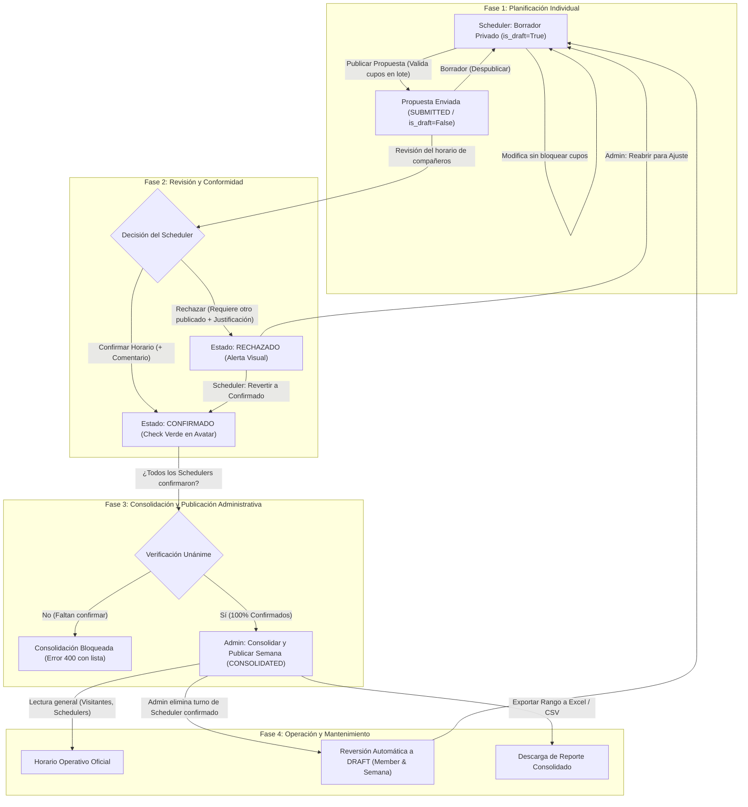

# Especificación Funcional e Historias de Usuario: Gestión de Horarios y Turnos por Equipos

## 1. Resumen Ejecutivo
El sistema permite la administración y gestión colaborativa de horarios de trabajo por turnos para equipos. Introduce flexibilidad mediante catálogos maestros de bloques configurables (jornada completa o media jornada, colores y cupos diarios), aislamiento y privacidad de borradores para miembros **SCHEDULER**, validación de cupos en lote al publicar, consolidación y publicación por administradores tras la confirmación unánime del equipo, confirmación formal semanal con indicadores visuales de conformidad (*check* verde), flujos de reversibilidad bidireccional ante discrepancias y exportación de reportes consolidados en Excel (.xlsx) y CSV con control de auditoría histórica.

---

## 2. Roles y Matriz de Permisos

| Rol | Alcance | Presencia en Grilla | Permisos Principales |
| :--- | :--- | :---: | :--- |
| **Admin / Manager** | Global o por Equipo | Opcional (si tiene asignado rol operativo SCHEDULER) | Crear/editar equipos, gestionar usuarios y credenciales, configurar catálogo de turnos, definir topes de cupos diarios por día de semana. Consolida y publica la semana una vez que **todos** los Schedulers confirmaron. Puede editar turnos en fechas pasadas/cerradas, reabrir semanas a borrador, revertir confirmaciones de miembros al eliminar turnos y exportar reportes consolidados (XLSX/CSV). |
| **Scheduler (Miembro Operativo)** | Propio Equipo | **Sí (Fila exclusiva)** | Miembro activo con turnos asignables. Planifica su borrador individual (privado hasta publicar), publica su propuesta (con validación de cupos en lote), puede despublicar a borrador, visualiza el consolidado del equipo, **confirma o rechaza** formalmente la semana con observaciones, y puede reconsiderar/revertir su propio rechazo a confirmado. Restringido para editar fechas pasadas y para editar una vez confirmado. |
| **Visitante [NombreEquipo]** | Asignado al Equipo | No | Modo solo lectura del horario consolidado del equipo asignado. No forma parte de la dotación operativa, no edita turnos y no requiere confirmar semanas. |

---

## 3. Reglas de Negocio Esenciales del Sistema

- **RN-01 (Exclusividad Operativa en Grilla):** En la grilla del horario compartido semanal, cada fila representa única y exclusivamente a un miembro con rol `SCHEDULER`. Los usuarios con rol `VISITANTE` o `ADMIN` puro no aparecen como filas. Si un Administrador requiere cubrir turnos operativos, se le asigna adicionalmente la participación como Scheduler.
- **RN-02 (Catálogo Maestro y Tipos de Jornada):** Los bloques de turno son gestionados por el Administrador en un catálogo maestro (ej. *REMOTO*, *PRESENCIAL*, *MEDIO DÍA*, *PERMISO*, *DÍA LIBRE*). Cada bloque tiene un color hexadecimal identificador y define si ocupa `Jornada Completa` (bloquea el día completo) o `Media Jornada` (bloquea la mañana o la tarde según horarios jornales).
- **RN-03 (Cupos Diarios y Estados de Consumo):** Las reglas de cupo diario (ej. cupo máximo de personas en REMOTO los días lunes) se configuran por equipo. 
  - En estado **BORRADOR**, el Scheduler puede seleccionar turnos libremente sin bloquear ni consumir cupos para otros miembros.
  - Al presionar **PUBLICAR**, el sistema ejecuta una validación en lote: si los cupos configurados están disponibles para cada día, las asignaciones pasan a estado público y consumen los cupos oficiales. Si un cupo se encuentra saturado por otro miembro que publicó antes, la publicación es denegada con un mensaje explicativo para que el miembro ajuste su propuesta a bloques con disponibilidad (ej. PRESENCIAL).
- **RN-04 (Aislamiento y Visibilidad de Borradores):** Mientras un Scheduler mantenga su propuesta en estado **BORRADOR**, sus asignaciones solo son visibles en su propia sesión individual. Los demás integrantes del equipo y el Administrador solo visualizarán los bloques de dicho colaborador una vez que presione **Publicar**. El Scheduler puede utilizar el botón **Borrador (Despublicar)** para regresar su propuesta a privado y liberar temporalmente los cupos reservados, siempre que la semana no esté confirmada ni consolidada.
- **RN-05 (Consolidación Condicionada a Confirmación Unánime):** El Administrador **únicamente** puede consolidar y publicar formalmente la semana cuando **todos** los miembros con rol `SCHEDULER` del equipo han confirmado su horario (`CONFIRMED`). Si algún miembro permanece en estado Borrador, Publicado o Rechazado, el sistema bloquea la consolidación y lista explícitamente los nombres de los colaboradores pendientes de confirmación.
- **RN-06 (Restricción de Edición en Fechas Pasadas):** Los miembros Scheduler tienen prohibido agregar, modificar o eliminar turnos en fechas anteriores a la fecha actual (`target_date < today`). Dicha potestad de ajuste retroactivo o regularización histórica queda reservada de forma exclusiva para los usuarios con rol `ADMIN`.
- **RN-07 (Protección de Integridad y Bloqueo Post-Confirmación):** Una vez que un miembro Scheduler confirma su horario semanal, sus celdas de turno quedan en modo lectura bloqueada. No puede realizar modificaciones directas salvo que el Administrador elimine o ajuste el turno (lo cual revierte automáticamente el estado del colaborador y de la semana a `BORRADOR` para exigir una nueva confirmación consciente).
- **RN-08 (Condición Previa para Rechazo Semanal):** Un colaborador SCHEDULER solo puede marcar su horario semanal como `RECHAZADO` si al menos otro colaborador SCHEDULER del equipo ya ha publicado su propuesta en dicha semana. Esto asegura que exista una contraparte visible con la cual contrastar discrepancias de dotación o cobertura compartida.
- **RN-09 (Reversibilidad Bidireccional de Rechazos):** Ante un rechazo registrado con justificación obligatoria:
  - El propio miembro Scheduler puede reconsiderar su decisión y pulsar **"Revertir a Confirmado"**, ingresando un comentario de visto bueno que actualiza su estado a `CONFIRMED` con su check verde.
  - El Administrador puede dialogar con el miembro y pulsar **"Reabrir para Ajuste"**, regresando la propuesta a `BORRADOR` para reajustar los turnos antes de consolidar.
- **RN-10 (Bloqueo de Rechazos en Semanas Consolidadas):** Una vez que la semana ha sido consolidada formalmente por el Administrador, ningún miembro puede pasar su estado a `RECHAZADO`. Cualquier modificación posterior debe ser gestionada por el Administrador.
- **RN-11 (Auditoría y Trazabilidad Histórica):** Cada cambio de estado de confirmación, rechazo, reapertura o reversión se almacena en una estructura de historial de auditoría (`rejection_history`) con timestamp UTC, identificador del usuario responsable y motivo documentado.
- **RN-12 (Exportación de Turnos Consolidados):** El sistema permite descargar el reporte de asignaciones operativas en un rango de fechas personalizado (mes, bimestre o rango libre) en formatos **Excel estilizado (.xlsx)** y **CSV delimitado por punto y coma**. Solo se incluyen asignaciones pertenecientes a semanas formalmente consolidadas por la Administración.

---

## 4. Modelo de Datos y Entidades Principales

```
+--------------------+        +---------------------+        +--------------------+
|        User        | 1    * |     TeamMember      | *    1 |        Team        |
+--------------------+--------+---------------------+--------+--------------------+
| id (PK)            |        | id (PK)             |        | id (PK)            |
| username (UQ)      |        | team_id (FK)        |        | name               |
| password_hash      |        | user_id (FK)        |        | description        |
| name               |        | role (Enum)         |        | rules_config (JSON)|
| email (UQ)         |        | participates (Bool) |        +--------------------+
| avatar_url         |        +---------------------+                  | 1
+--------------------+                                                 |
         | 1                                                           | *
         |                                                   +--------------------+
         | *                                                 |   WeeklySchedule   |
+------------------------------------+                       +--------------------+
|    WeeklyScheduleMemberStatus      |                       | id (PK)            |
+------------------------------------+                       | team_id (FK)       |
| id (PK)                            |                       | year (Int)         |
| weekly_schedule_id (FK)            |                       | week_number (Int)  |
| user_id (FK)                       |                       | status (Enum)      |
| workflow_state (DRAFT/SUB/CONF/REJ)|                       +--------------------+
| feedback_comment (Text)            |                                 | 1
| confirmed_at (DateTime)            |                                 |
| rejection_history (JSON List)      |                                 | *
+------------------------------------+                       +--------------------+
                 | 1                                         |  ShiftAssignment   |
                 |                                           +--------------------+
                 | *                                         | id (PK)            |
+------------------------------------+                       | weekly_schedule_id |
|         ShiftBlockCatalog          | 1                   * | user_id (FK)       |
+------------------------------------+-----------------------+ date (YYYY-MM-DD)  |
| id (PK)                            |                       | shift_block_id (FK)|
| name (UQ)                          |                       | period (Enum)      |
| color (Hex String)                 |                       | is_draft (Bool)    |
| duration_type (FULL_DAY/HALF_DAY)  |                       +--------------------+
| requires_coverage (Bool)           |
+------------------------------------+
```

---

## 5. Ciclo de Vida Semanal y Flujo de Estados



---

## 6. Historias de Usuario Detalladas (User Stories)

### HU-01: Gestión de Equipos, Miembros y Roles
**Como** Administrador del Sistema  
**Quiero** registrar y mantener equipos, asociando colaboradores con roles delimitados (`ADMIN`, `SCHEDULER`, `VISITANTE [Equipo]`)  
**Para** garantizar que la planificación operativa se concentre exclusivamente en los colaboradores designados y restringir accesos según responsabilidades.

#### Criterios de Aceptación (BDD):
- **Criterio 1.1 (Creación de Equipos y Miembros):**
  - **Dado** que el Administrador accede al panel de Equipos.
  - **Cuando** crea un nuevo equipo indicando nombre y descripción, y añade a un usuario seleccionando rol `SCHEDULER`.
  - **Entonces** el usuario queda registrado como miembro activo con participación horaria (`participates_in_schedule = True`).
- **Criterio 1.2 (Restricción de Visitantes):**
  - **Dado** un usuario asignado a un equipo con rol `VISITANTE`.
  - **Cuando** consulta el módulo del equipo.
  - **Entonces** solo tiene acceso en modo lectura al horario consolidado; no puede editar bloques, no aparece como fila de turnos y no tiene acciones de confirmación.
- **Criterio 1.3 (Participación Operativa de Administradores):**
  - **Dado** un usuario con rol `ADMIN`.
  - **Cuando** no tiene asignada la condición de Scheduler, no figura en la grilla de turnos compartida.
  - **Entonces** si el Administrador debe cubrir turnos presenciales o remotos, se le asigna adicionalmente el rol de Scheduler para habilitar su fila en el horario.

---

### HU-02: Catálogo Maestro de Bloques de Turno y Colores
**Como** Administrador  
**Quiero** parametrizar un catálogo de bloques de turno con nombre único, color hexadecimal, tipo de jornada y necesidad de cobertura  
**Para** estandarizar los tipos de disponibilidad y facilitar la identificación visual en la grilla horaria.

#### Criterios de Aceptación (BDD):
- **Criterio 2.1 (Configuración de Bloques):**
  - **Dado** el catálogo maestro, el Administrador puede crear bloques como *REMOTO*, *PRESENCIAL*, *PERMISO*, *MEDIO DÍA*, *DÍA LIBRE* y *GUARDIA*.
  - **Cuando** se define un bloque, se establece obligatoriamente su color hexadecimal (ej. `#3B82F6`) y su tipo de jornada (`FULL_DAY` o `HALF_DAY`).
- **Criterio 2.2 (Impacto de Jornada Completa vs Media Jornada):**
  - **Dado** un turno de jornada completa asignado a una fecha, cuando se registra, ocupa la totalidad de la jornada del colaborador.
  - **Dado** un turno de media jornada (ej. *MEDIO DÍA*), cuando se asigna, bloquea únicamente el turno de la mañana (`FIRST_HALF`) o la tarde (`SECOND_HALF`), permitiendo respetar horarios jornales parciales.
- **Criterio 2.3 (Control de Cobertura):**
  - **Dado** un bloque con `requires_coverage = False` (ej. *DÍA LIBRE* o *PERMISO*), cuando se asigna, no se contabiliza en el cómputo de cupos restrictivos del equipo.

---

### HU-03: Control y Validación de Cupos Diarios por Equipo
**Como** Administrador  
**Quiero** establecer topes máximos por tipo de bloque y por día de semana (ej. máximo 1 persona en REMOTO los lunes)  
**Para** asegurar la cobertura física y operativa requerida en la sede laboral.

#### Criterios de Aceptación (BDD):
- **Criterio 3.1 (No Consumo en Borrador):**
  - **Dado** un equipo con cupo de 1 REMOTO para los días lunes.
  - **Cuando** el Scheduler A y el Scheduler B asignan el bloque REMOTO el lunes en estado `BORRADOR`.
  - **Entonces** el sistema les permite guardar temporalmente su selección en borrador sin rechazo inmediato, pues aún no es una propuesta oficial.
- **Criterio 3.2 (Validación en Lote al Publicar):**
  - **Dado** que el Scheduler A publica su propuesta el lunes con bloque REMOTO.
  - **Cuando** el Scheduler B intenta presionar "Publicar", el sistema analiza la disponibilidad de cupos en lote y detecta que el límite de 1 REMOTO está agotado.
  - **Entonces** el sistema deniega la publicación con error 400 detallando el día y bloque saturado, manteniendo al Scheduler B en borrador para que ajuste su turno a *PRESENCIAL* antes de publicar.

---

### HU-04: Grilla Semanal Exclusiva para Miembros SCHEDULER y Navegación ISO
**Como** Usuario del Sistema (Scheduler, Administrador o Visitante)  
**Quiero** visualizar una grilla semanal donde cada fila corresponda exclusivamente a un miembro SCHEDULER y las columnas representen los 7 días de la semana  
**Para** interpretar de forma inmediata y sin ruidos visuales la dotación programada del equipo.

#### Criterios de Aceptación (BDD):
- **Criterio 4.1 (Filtrado de Grilla):**
  - **Dado** el acceso a una semana específica (ej. Semana 44).
  - **Cuando** la grilla se despliega, únicamente se muestran filas pertenecientes a miembros con rol `SCHEDULER`. Los Administradores puros y Visitantes quedan fuera de las filas de asignación.
- **Criterio 4.2 (Colores y Celdas de Turno):**
  - **Dado** un turno asignado en la grilla, cada celda renderiza la pastilla con el nombre del bloque y el color de fondo configurado en el catálogo.
- **Criterio 4.3 (Navegación de Semanas y Resolución ISO):**
  - **Dado** el selector de navegación semanal, el sistema calcula de manera precisa los límites de año ISO (semanas 52/53 y semana 1 del siguiente año) y ofrece un botón de acceso directo a la "Semana Actual".

---

### HU-05: Planificación Individual, Aislamiento de Borradores y Publicación
**Como** Miembro SCHEDULER  
**Quiero** contar con un espacio de borrador privado para planificar mi disponibilidad y publicarla cuando esté listo  
**Para** no generar confusiones con asignaciones tentativas antes de presentar mi propuesta formal al equipo.

#### Criterios de Aceptación (BDD):
- **Criterio 5.1 (Privacidad del Borrador):**
  - **Dado** un Scheduler que edita sus turnos en estado `BORRADOR`.
  - **Cuando** otros integrantes del equipo o el Administrador consultan la grilla compartida.
  - **Entonces** las celdas de este colaborador se muestran vacías para el resto; solo el propio colaborador visualiza sus bloques en su sesión.
- **Criterio 5.2 (Publicación de Propuesta):**
  - **Dado** un Scheduler con sus bloques cargados en borrador.
  - **Cuando** hace clic en "Publicar Propuesta" y los cupos diarios son validados con éxito.
  - **Entonces** su estado cambia a `SUBMITTED`, sus bloques pasan a `is_draft = False` y se vuelven visibles en la grilla compartida del equipo.
- **Criterio 5.3 (Despublicar / Retornar a Borrador):**
  - **Dado** un Scheduler en estado `SUBMITTED` que requiere ajustar sus turnos antes de que la semana se consolide.
  - **Cuando** presiona el botón "Borrador" (unpublish).
  - **Entonces** su estado regresa a `DRAFT`, sus asignaciones se marcan nuevamente como borrador privado y libera los cupos reservados para permitir ediciones.

---

### HU-06: Confirmación Semanal Exclusiva con Indicador Check y Protección de Turnos
**Como** Miembro SCHEDULER  
**Quiero** formalizar mi conformidad con el horario semanal consolidado mediante una confirmación explícita  
**Para** brindar tranquilidad operativa y reflejar un indicador visible de conformidad en el equipo.

#### Criterios de Aceptación (BDD):
- **Criterio 6.1 (Confirmación con Observaciones):**
  - **Dado** un horario semanal publicado, cuando el miembro SCHEDULER revisa su asignación y presiona "Confirmar Horario", puede ingresar un comentario opcional.
  - **Entonces** su estado cambia a `CONFIRMED`, registrando la fecha/hora en `confirmed_at` y mostrando un icono de **check verde visible** en su avatar/nombre en la grilla.
- **Criterio 6.2 (Bloqueo de Edición Post-Confirmación):**
  - **Dado** un colaborador en estado `CONFIRMED`.
  - **Cuando** intenta hacer clic en una celda para alterar o eliminar un bloque.
  - **Entonces** el sistema bloquea la acción con error 403, indicando que sus turnos están confirmados y solo el Administrador puede coordinar cambios.
- **Criterio 6.3 (Exclusividad del Rol):**
  - **Dado** un usuario que no posee rol SCHEDULER, cuando intenta invocar la confirmación de turnos, el sistema deniega la solicitud por falta de privilegios operativos.

---

### HU-07: Rechazo de Horario Condicionado, Discrepancia Obligatoria y Reversibilidad
**Como** Miembro SCHEDULER o Administrador  
**Quiero** manifestar inconformidad justificada ante un cruce de horario y disponer de opciones de reversión o reapertura  
**Para** resolver discrepancias sin bloquear permanentemente el flujo semanal.

#### Criterios de Aceptación (BDD):
- **Criterio 7.1 (Condición de Rechazo y Justificación):**
  - **Dado** un Scheduler disconforme con su asignación semanal.
  - **Cuando** intenta rechazar sin que ningún otro compañero Scheduler haya publicado su propuesta, la acción es denegada (error 400).
  - **Cuando** existe al menos otro miembro con propuesta publicada y el usuario ingresa una justificación obligatoria (mínimo 3 caracteres), el sistema aprueba el rechazo, pasa a `REJECTED` y despliega una alerta visual de atención.
- **Criterio 7.2 (Reversión por el Colaborador):**
  - **Dado** un horario en estado `RECHAZADO`.
  - **Cuando** el colaborador resuelve su incompatibilidad (ej. reprogramación de examen o viaje) y presiona "Revertir a Confirmado".
  - **Entonces** su estado se actualiza a `CONFIRMED` con su check verde, registrando el motivo en el historial de auditoría.
- **Criterio 7.3 (Reapertura por el Administrador):**
  - **Dado** un horario en estado `RECHAZADO` reportado al Administrador.
  - **Cuando** el Administrador llega a un acuerdo con el colaborador y hace clic en "Reabrir para Ajuste".
  - **Entonces** el estado del colaborador vuelve a `BORRADOR` para permitir la modificación de los bloques en conflicto.
- **Criterio 7.4 (Bloqueo tras Consolidación):**
  - **Dado** un horario que ya ha sido consolidado formalmente por el Administrador (`CONSOLIDATED`).
  - **Cuando** un colaborador intenta rechazar la semana.
  - **Entonces** el sistema deniega la acción, notificando que una semana consolidada no admite rechazos directos.

---

### HU-08: Consolidación y Publicación Administrativa Unánime y Regularización de Turnos
**Como** Administrador del Equipo  
**Quiero** consolidar y publicar formalmente el horario semanal únicamente cuando todos los Schedulers hayan confirmado, y gestionar regularizaciones excepcionales  
**Para** asegurar que no existan semanas vigentes con inconformidades pendientes y mantener el control histórico de la operación.

#### Criterios de Aceptación (BDD):
- **Criterio 8.1 (Consolidación Condicionada al 100% de Confirmados):**
  - **Dado** un equipo con 2 o más miembros SCHEDULER.
  - **Cuando** el Administrador presiona "Consolidar Semana" y algún miembro permanece en estado `DRAFT`, `SUBMITTED` o `REJECTED`.
  - **Entonces** el sistema bloquea la operación con error 400 y muestra un mensaje detallado con los nombres de los colaboradores que faltan confirmar.
  - **Cuando** el 100% de los Schedulers se encuentran en estado `CONFIRMED`.
  - **Entonces** la semana pasa a estado `CONSOLIDATED` (Publicada formalmente).
- **Criterio 8.2 (Restricción de Días Pasados y Excepción de Administrador):**
  - **Dado** un miembro SCHEDULER, cuando intenta asignar turnos en una fecha anterior a la fecha actual (`target_date < today`), el sistema rechaza la petición (error 400).
  - **Dado** un Administrador (`operator_id = admin`), cuando requiere regularizar asistencias o turnos pasados, el sistema permite la inserción o actualización histórica.
- **Criterio 8.3 (Reversión por Modificación Administrativa en Turno Confirmado):**
  - **Dado** un horario semanal consolidado con miembros en estado `CONFIRMED`.
  - **Cuando** el Administrador elimina o reemplaza un bloque de turno de un miembro confirmado.
  - **Entonces** el sistema revierte automáticamente el estado del colaborador a `DRAFT` y la semana general a `DRAFT`, asegurando que el cambio no pase desapercibido y deba ser reconfirmado.

---

### HU-09: Exportación de Turnos Consolidados (Excel y CSV)
**Como** Administrador o Líder de Operaciones  
**Quiero** exportar los turnos asignados dentro de un rango de fechas en formatos Excel estilizado (.xlsx) y CSV  
**Para** alimentar reportes de nómina, control de asistencia, auditoría laboral y análisis de dotación en herramientas de Business Intelligence.

#### Criterios de Aceptación (BDD):
- **Criterio 9.1 (Filtro por Rango y Semanas Consolidadas):**
  - **Dado** el panel de exportación, el Administrador selecciona un rango de fechas (ej. mes completo del 01 al 31).
  - **Cuando** solicita la exportación, el sistema filtra y extrae únicamente los turnos que pertenecen a semanas que han sido debidamente consolidadas (`CONSOLIDATED`).
- **Criterio 9.2 (Generación de Archivo Excel .xlsx Estilizado):**
  - **Dado** el formato seleccionado `xlsx`.
  - **Cuando** se genera el archivo mediante `openpyxl`.
  - **Entonces** incluye banner institucional, metadatos de fechas, encabezados con formato, celdas de turno coloreadas según el color configurado en el catálogo y columnas dimensionadas automáticamente.
- **Criterio 9.3 (Generación de Archivo CSV):**
  - **Dado** el formato seleccionado `csv`.
  - **Cuando** se genera el archivo.
  - **Entonces** incluye codificación UTF-8 con BOM (para compatibilidad total con MS Excel) y delimitador estándar de punto y coma (`;`).

---

### HU-10: Autenticación, Sesiones y Seguridad de Acceso
**Como** Usuario del Sistema  
**Quiero** iniciar y cerrar sesión mediante credenciales seguras y mantener mi sesión activa en el navegador  
**Para** proteger la integridad de los datos y asegurar que cada acción quede asociada a mi identidad.

#### Criterios de Aceptación (BDD):
- **Criterio 10.1 (Inicio de Sesión y Autenticación):**
  - **Dado** el formulario de login, cuando el usuario ingresa su nombre de usuario y contraseña válida.
  - **Entonces** el sistema valida el hash de contraseña, genera la cookie de sesión (`noti_session_user_id`) y redirige a la pantalla principal según su rol.
- **Criterio 10.2 (Control de Sesión Actual):**
  - **Dado** un usuario autenticado, el endpoint `/api/auth/current-user` provee su perfil, roles en equipos y permisos habilitados.
- **Criterio 10.3 (Cierre de Sesión):**
  - **Dado** un usuario que presiona "Cerrar Sesión", el sistema invalida la cookie y redirige de inmediato a la pantalla de login.
